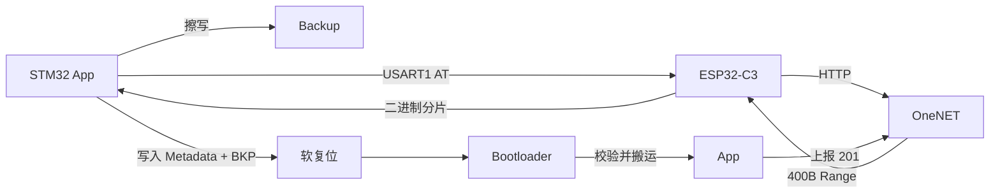

# STM32 Single-Staging OTA Bootloader

基于 STM32F103C8T6、ESP32-C3 和 OneNET 的单暂存区 OTA 升级示例。

设备通过 USART1 控制 ESP32-C3 执行 AT 指令，从 OneNET 查询固件任务并按
HTTP Range 分片下载到内部 Backup 区。下载完成后软复位进入 Bootloader，
Bootloader 根据 Metadata 把固件搬运到 App 区，完成回读校验后跳转。

## 功能

- 20KB Bootloader / 20KB App / 20KB Backup / 4KB Metadata Flash 分区
- OneNET 升级任务查询与 400B 分片下载
- `+HTTPCLIENT:<n>` 二进制载荷解析和分片重试
- Metadata CRC32、magic 提交顺序和升级任务记录
- BKP 升级请求、安装完成标志和升级状态上报
- App 向量表检查、MSP/Thumb/VTOR 重定位及程序跳转
- USART2 串口日志和 LED 故障提示

## Flash 布局

| 区域 | 起始地址 | 大小 | 用途 |
|---|---:|---:|---|
| Bootloader | `0x08000000` | 20KB | 启动校验、固件搬运 |
| App | `0x08005000` | 20KB | 当前运行程序 |
| Backup | `0x0800A000` | 20KB | 新固件暂存 |
| Metadata | `0x0800F000` | 4KB | 升级任务和固件信息 |

App 必须使用仓库内的 `WI-FI/STM32F103XX_FLASH.ld`，从
`0x08005000` 链接。

## 升级流程



1. App 查询 OneNET，并比较当前 Metadata 与平台任务。
2. 固件按 400B 分片下载到 Backup 区。
3. 下载完成后写入 Metadata，设置 `BKP->DR1` 并软复位。
4. Bootloader 读取 Metadata，擦除 App 区并搬运 Backup。
5. 回读校验通过后清除 `DR1`、设置 `DR2`，校验向量表并跳转 App。
6. 新 App 启动后上报升级成功状态，并清除 `DR2`。

## 硬件连接

| STM32F103 | ESP32-C3 | 用途 |
|---|---|---|
| PA9 / USART1_TX | RX | AT 指令发送 |
| PA10 / USART1_RX | TX | AT 应答接收 |
| PA2 / USART2_TX | USB-UART RX | 调试日志 |
| PA3 / USART2_RX | USB-UART TX | 调试输入 |

调试串口为 `115200-8-N-1`。

## 构建

需要以下工具：

- CMake 3.22+
- Ninja
- `arm-none-eabi-gcc`

先创建本地凭据文件：

```bash
cp WI-FI/APP/app/secrets.example.h WI-FI/APP/app/secrets.h
```

修改 `secrets.h` 中的 Wi-Fi、OneNET 产品、设备及 Authorization 信息。
该文件已被 `.gitignore` 排除，不要提交真实凭据。

构建 Bootloader：

```bash
cmake --preset Debug
cmake --build --preset Debug
```

在 `BOOTLOADER` 目录和 `WI-FI` 目录分别执行上述命令。产物位于各自的
`build/Debug/` 目录。

初次烧录时先写入 Bootloader，再将 App 写到 `0x08005000`。后续升级通过
平台下发固件完成。

## 目录结构

```text
BOOTLOADER/   启动校验、Flash 搬运与 App 跳转
WI-FI/        App、ESP32 AT 驱动、OneNET OTA 与 Metadata 实现
```

`WI-FI/串口输出说明.txt` 记录了串口日志和 OneNET 状态码说明。

## 已知限制

- 当前为单暂存区方案，Backup 只保存新固件。
- Metadata 的 CRC32 只保护升级记录，尚未校验 Backup 固件内容。
- App 区回读校验验证的是 App 与 Backup 一致，不等价于固件来源可信。
- 安装请求使用 BKP 标记；无 VBAT 时，实际掉电可能丢失标记。
- 尚未实现新固件健康确认、自动回滚和固件签名验证。
- Wi-Fi 连接和 OTA 下载采用阻塞式 AT 交互。

这些问题适合作为后续可靠性和量产化改进方向。

## 安全说明

不要提交以下信息：

- Wi-Fi SSID 和密码
- OneNET 产品 ID、设备 ID 和 Authorization 签名
- 其他设备密钥或私有证书

如凭据曾进入公开提交历史，应立即在对应平台重新生成。

## License

用户自行编写的应用代码未声明额外许可证。`Drivers/` 下的 STM32 HAL 和
CMSIS 文件遵循各自目录中的许可证。

